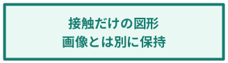
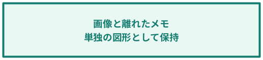

# [画像と注釈の比較] シート

**画像と注釈の比較 / 同じ画面に異なる図形を重ねた例**

画面は同じPNGを2か所へ配置。赤枠・青枠・注釈はExcelで編集できる図形です。  
<strong>① 赤枠 ＋ 画像の外にはみ出す注釈</strong>　<strong>② 同じ元画像 ＋ 別の青い注釈</strong>

図中の項目:

- shape-1-1（画像）：架空の申請一覧画面。元画像はscreen\-Bと同一。
- shape-3（長方形）：文字なし
- shape-4（長方形）：**送信前に** **状態を確認**

接続関係:

- shape-1-5：shape-3（文字なし） → shape-4「送信前に 状態を確認」

![{"type":"図","text":"","x":47.261,"y":100,"width":614.399,"height":380,"sourceIds":["shape-1-1","shape-3","shape-4","shape-1-5"]}](images/image-0001.png)

図中の項目:

- shape-2（画像）：架空の申請一覧画面。元画像はscreen\-Aと同一。
- shape-7（長方形）：**受付番号を確認** **別の注釈を保持**

![{"type":"図","text":"","x":756.184,"y":100,"width":614.399,"height":300,"sourceIds":["shape-2","shape-6","shape-7"]}](images/image-0002.png)

図中の項目:

- shape-8（長方形）：**接触だけの図形** **画像とは別に保持**

青い注釈は元画像の右へはみ出します。緑の図形は画像右端に接するだけで、重なる面積はありません。

赤枠は画面内に重なります。注釈は画面の右下へはみ出し、赤枠との保存済み接続を持ちます。

図中の項目:

- shape-9（長方形）：**画像と離れたメモ** **単独の図形として保持**

全て架空の内容です。同じ元画像でも注釈が異なれば別の合成結果になり、図形文字と確認できた接続はMarkdownに残ります。

# [画像同士の重なり] シート

**画面に別の画面を重ねる / 画像だけでも1枚に合成**

画像の重なり順と位置を保持。図形がなくても、重なる画像は同じ出力画像へまとめます。

図中の項目:

- shape-1（画像）：背面の画面
- shape-2（画像）：手前に重ねた画面

![{"type":"図","text":"","x":52.513,"y":110,"width":840.204,"height":462,"sourceIds":["shape-1","shape-2"]}](images/image-0003.png)

# [表と画像と注釈] シート

**表の文字も画像も注釈も保持**

| **対象** | **担当** | **確認ポイント** | **画面 / 状態** | **備考** |
| --- | --- | --- | --- | --- |
| 申請一覧 | 業務担当 | 受付番号と状態 |  | 画面上の赤枠を確認 |
| 承認一覧 | 管理担当 | 承認待ちの表示 |  | 操作手順を添付 |
| 保存結果 | 開発担当 | 処理履歴 | 正常 | Markdownにも表を保持 |

図中の項目:

- shape-1（画像）：表に重なる画面
- shape-3（長方形）：**画面と確認箇所を** **まとめて確認**

![{"type":"図","text":"","x":0,"y":108,"width":588.143,"height":180,"cellRanges":["A4:E7"],"sourceIds":["shape-1","shape-2","shape-3"]}](images/image-0004.png)

表はMarkdownにも残ります。合成画像内の表や図形文字をOCRへ重複送信しません。
