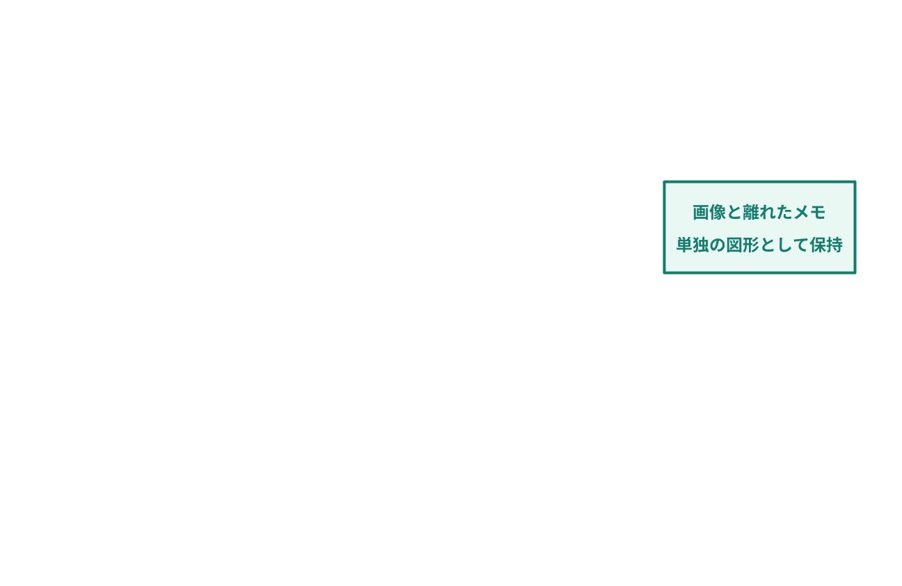

[page 1]

# PowerPoint / 画面画像と編集可能な注釈

赤枠は画像内、注釈は右下へはみ出します。緑のメモは画像から離しています。

**送信前に**
**状態を確認**

図中の項目:

- shape-4（画像、スライド中央）：架空の申請一覧画面。赤枠と注釈は別の編集可能な図形。

![{"type":"図","text":"","x":45,"y":135,"width":745,"height":427,"sourceIds":["shape-4","shape-5","shape-6"],"positionOnSlide":"center-middle"}](images/image-0001.png)

図中の項目:

- shape-7（長方形、スライド右中央）：**画像と離れたメモ** **単独の図形として保持**

[page 2]

# PowerPoint / 画像の上に画像を重ねる

画面全体に拡大画像を重ねています。画像だけの重なりも1枚へまとめます。

図中の項目:

- shape-4（画像、スライド中央）：架空の申請一覧画面
- shape-5（画像、スライド右下）：状態欄と送信ボタンの拡大画像

![{"type":"図","text":"","x":45,"y":145,"width":865,"height":360,"sourceIds":["shape-4","shape-5"],"positionOnSlide":"center-middle"}](images/image-0002.png)

[page 3]

# PowerPoint / 表に重なる画像・図形・文字

表はMarkdownの表として残し、重なりを保った見た目も1枚のPNGにします。

| **確認項目** | **担当** | **状態** |
| --- | --- | --- |
| 申請内容 | 営業 | 確認済み |
| 承認条件 | 管理 | 再確認 |
| 送信前確認 | 担当者 | 未着手 |

**承認条件を再確認**

図中の項目:

- shape-6（画像、スライド右下）：表の右下に重なる補足画面

![{"type":"図","text":"","x":45,"y":165,"width":860,"height":422,"sourceIds":["shape-4","shape-5","shape-6","shape-7"],"positionOnSlide":"center-middle"}](images/image-0003.png)

