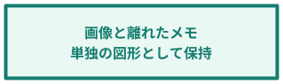

[page 1]

# **Word / 画面画像と編集可能な注釈**

同じ段落のページ基準で配置した画像・赤枠・注釈です。図形は画像に焼き込まず、Wordで編集できます。

図中の項目:

- shape-1（画像）：架空の申請一覧画面。赤枠と注釈は別の編集可能な図形。
- shape-3（長方形）：送信前に 状態を確認

![{"type":"図","text":"","x":54,"y":155,"width":481,"height":288,"sourceIds":["shape-1","shape-2","shape-3"]}](images/image-0001.png)

図中の項目:

- shape-1（長方形）：画像と離れたメモ 単独の図形として保持

赤枠と右下の注釈は画面画像へ重なります。緑のメモは画像から離れた場所にあります。

[page 2]

# **Word / 画像の上に画像を重ねる**

同じ画面を縮小して右下へ重ねています。画像同士の重なりも1枚にまとめます。

図中の項目:

- shape-1（画像）：架空の申請一覧画面。
- shape-2（画像）：同じ画面を縮小した画像。

![{"type":"図","text":"","x":54,"y":160,"width":461,"height":297,"sourceIds":["shape-1","shape-2"]}](images/image-0002.png)

[page 3]

# **Word / 固定位置の表と画像・図形**

固定列幅・固定行高・保存位置を持つ浮動表です。表の文字はMarkdownにも保持します。

| **項目** | **担当** | **状態** |
| --- | --- | --- |
| 申請内容 | 営業 | 確認済み |
| 承認条件 | 管理 | 再確認 |

図中の項目:

- shape-46（画像）：表に重なる補足画面。
- shape-47（長方形）：確認対象を強調

![{"type":"図","text":"","x":50,"y":170,"width":490,"height":201,"includesTable":true,"tableRange":"table:1","sourceIds":["shape-46","shape-47"]}](images/image-0003.png)

