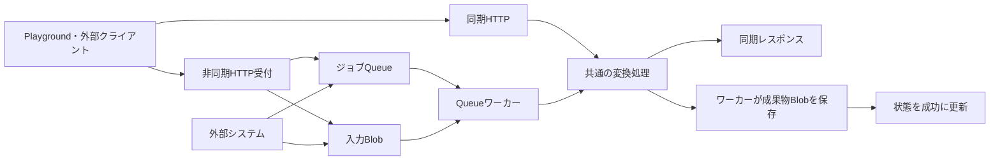

# 全体構成

各機能は独立したFunction Appへ配置するFunctionsプロジェクトです。画像・Office・Markdown変換はJava 21、Movie → AudioはNode.js 22 / 24、HTML → PowerPointはNode.js 24です。共通の親ビルドや、機能間で共有する実行時ライブラリはありません。必要な機能だけをビルド・配置します。非同期に対応する6機能はHTTPとQueueで変換処理を共有し、HTML → PowerPointは同期HTTPとCLIで共有します。

```text
convertX2X/
├── docs/                         開発者マニュアル
├── functions/
│   ├── office2md/              独立したビルド・設定・デプロイ単位
│   ├── office2pdf/             独立した純Java Office→PDFアプリ
│   ├── excel2img/              独立したExcel配置保持の描画アプリ
│   ├── md2pdf/                 独立した純Java Markdown→PDFアプリ
│   ├── ppt-pdf-to-images/        独立したビルド・設定・デプロイ単位
│   ├── movie2audio/             独立したビルド・設定・デプロイ単位
│   └── html2pptx/               Node.js・Chromiumの同期HTTP・CLIアプリ
├── .agents/skills/convertx2x/    API利用・変更とHTML生成のスキル
└── CONTRIBUTING.md               変更時の共通ルール
```

非同期に対応する6機能の処理は次の形です。PlaygroundもHTTP APIのクライアントで、画面固有の変換処理は持ちません。HTML → PowerPointには図の非同期経路はありません。



図のレスポンス返却とBlob保存は、呼び出した経路によって分かれます。直接Queueへ送るのは入力Blobの参照を含むJSONをBase64化したメッセージです。SDKのエンコード設定か手動処理のどちらかで1回だけ適用します。文書・動画のファイル本体や認証情報はQueueに入れません。

| 機能 | 実装・共通変換処理 | 既定ポート / Queue | 同期出力 / 非同期保存 |
| --- | --- | --- | --- |
| Office → Markdown | Java 21・POI / `OfficeMarkdownService` | `7072` / `office2md-jobs` | Markdown・画像・reportのZIP / 個別Blob |
| Office → PDF | Java 21・POI・PDFBox / `OfficePdfService` | `7074` / `office2pdf-jobs` | PDF / PDF・reportの個別Blob |
| Markdown → PDF | Java 21・CommonMark・PDFBox / `MarkdownPdfService` | `7075` / `md2pdf-jobs` | PDF / PDF・reportの個別Blob |
| Excel → 画像・PDF | Java 21・POI・Java2D・PDFBox / `ExcelImageService` | `7076` / `excel2img-jobs` | PNG群またはPDFとreportのZIP / 個別Blob |
| PowerPoint / PDF → 画像 | Java 21・POI・PDFBox / `ConversionService` | `7071` / `conversion-jobs` | 単ページ画像または全ページZIP / 単画像・ZIPまたは画像とmanifestの個別Blob |
| Movie → Audio | Node.js 22・24・FFmpeg / `extractAudio` | `7073` / `movie2audio-jobs` | M4A・WAV、SAS保存は結果JSON / 音声の個別Blob |
| HTML → PowerPoint | Node.js 24・Chromium / `src/service.js`・`src/engine.js` | `7077` / 未対応 | PPTXとreportのZIP、またはPPTX本体 / 未対応 |

Javaの既定配布先は機能内の `target/azure-functions/<機能名>-local/` です。PowerPoint / PDF → 画像のみ `slide2image-local/` を使います。Movie → AudioとHTML → PowerPointはそれぞれの `dist/` へパッケージ化します。

Excel → 画像・PDFは、広い範囲を文字サイズ等の下限まで縮小し、それでも収まらなければ横方向にも分割します。縦方向も分割し、横幅だけを理由に範囲を見送りません。元の文字が小さい場合の警告、ページ数・画素数等の上限は別に適用します。[実装ガイド](excel2img.md)を参照してください。

HTTPのパスが似ていても、QueueのJSONや結果の取得方法は機能ごとの契約です。対象機能の依頼形式に合わせてください。

Movie → Audioは `POST /api/convert` に動画、`POST /api/convert-url` にURLのJSONを送り、共通の `src/ffmpeg.js` で最初の音声トラックを扱います。既定はAACを `audio.m4a` へコピーし、明示的なtranscodeではM4A/AACまたはWAV/16bit PCMへ変換します。非同期では `POST /api/jobs`・`POST /api/jobs-url` からQueueへ登録し、直接Queueのversion 2でも音声オプションを指定できます。URL入力は許可ホスト設定時、非同期は制御用Storage設定時だけ有効です。[Movieの実装ガイド](movie2audio.md)を参照してください。

HTML → PowerPointは、HTML/CSSを検査して同梱Chromiumで配置を計算し、文字・表・CSS/SVG図形を編集可能なPPTXへ変換します。元のPNG/JPEGは画像として保持し、対応するCSSアニメーションは動きへ、未対応の動きは終端の静止状態へ変換します。画像化で代替できない静止状態の制約はエラーとして返します。入力JavaScriptや外部素材の取得は実行しません。Storage設定で非同期が有効になることはありません。[実装ガイド](html2pptx.md)を参照してください。

Movieの呼び出し契約は [同期HTTP](APIDocs/movie2audio/http.html)・[同期SAS保存](APIDocs/movie2audio/storage.html)・[非同期HTTP](APIDocs/movie2audio/jobs.html)・[直接Queue](APIDocs/movie2audio/queue.html) に分かれます。実装変更時は、共有するFFmpeg処理と実行枠、入力・出力の容量、処理期限、再試行時の結果公開を確認します。ローカルFunctionsとAzuriteを使う手順は [開発環境と検証](development.md#movie--audioの実変換) にあります。

## 外部システムとの接続

非同期に対応するFunction Appは、接続文字列またはManaged Identityで登録済みStorageへ接続します。直接Queueのversion 2には、期待する入力ETag、任意metadata、登録済み結果Queueへの通知を追加できます。version 1の依頼は維持します。

成果物は試行ごとに保存し、全成果物が揃った結果だけを確定します。終端状態が通知送信待ちの永続記録にもなり、通知障害で変換を再実行しません。保持機能は既定無効で、設定時は所有記録とETagに基づいて成果物を清掃します。利用側の最新revisionへの採用判断と、検索・一覧への登録範囲は利用側が管理します。

実際の環境変数、ホスト認証、Private Endpoint、保持と重複判定の範囲は[配置・運用手順](development.md#8-managed-identity閉域storage結果通知)を参照してください。文字起こしはMovie → Audioの成功条件に含めません。
