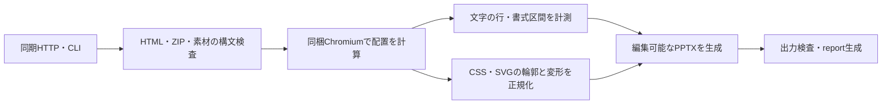

# html2pptx 設計

2026-10-30更新。静的HTML/CSSの見た目をできるだけ保ち、文字・図形・表をPowerPoint上で編集できる形へ変換する。元のPNG/JPEGは画像として保持し、文字・図形をスライド画像へ置き換えることで代替しない。

現行実装は独立した `functions/html2pptx/` のNode.js 24アプリで、同期HTTP・CLIに対応する。Azure Functions Flex Consumption・4096 MBを配置先とする。非同期HTTP・直接Queueは未実装。API・設定値は [利用ガイド](../../functions/html2pptx/docs/usage.md)、ファイルの役割と検証手順は [開発者ガイド](../html2pptx.md) を参照する。

## 現在の契約

| 項目 | 仕様 |
| --- | --- |
| 入力 | UTF-8の `.html` / `.htm`、またはルートの `index.html` / `index.htm` と素材を含むZIP |
| 素材 | ZIP内の相対CSS・PNG/JPEG・SVG。HTML単体はインラインCSS/SVGとPNG/JPEGのdata URI |
| スライド境界 | `data-slide` のDOM順。指定がなければ本文全体を1枚。入れ子は拒否 |
| 寸法 | 既定1280×720 CSS px。幅・高さのmetaを両方指定して変更可能 |
| 編集対象 | HTML/SVGの文字、対応する装飾、表、CSS/SVGの輪郭・線・塗り |
| 元画像 | PPTXへ画像として埋め込み。移動・サイズ変更・差し替え可能 |
| 出力 | `presentation.pptx` と `report.json` のZIP。HTTPの `format=pptx` でPPTX本体も返せる |
| 入口 | `POST /api/convert`、軽量Playground、capabilities、CLI |
| 外部取得・実行 | URLからのHTML・素材取得、入力JavaScript、イベント属性は受け付けない |

文章の要約、長いページの自動分割、図の意味の解釈、LLMによる配置生成は行わない。Flex/Gridはブラウザーが計算した座標を出力し、PowerPoint内で同じ自動配置機能を再現するものではない。

## 変換の構成

Puppeteer Core＋Chromiumで実際のCSS配置を計算し、固定バージョンのdom-to-pptx／PptxGenJSによる出力を補正する。dom-to-pptxがSVGを画像オブジェクトとして出す部分は、そのまま成果物に残さず、DrawingMLの図形・文字へ置換する。変換器へのフックは元バンドルのSHA-256と挿入位置を確認してから適用し、依存更新時に無条件で継続しない。

Java/POIは本番の変換エンジンとして使用しない。検証用PPTX描画に使うPOI/PDFBoxは開発ツールであり、Functionsの実行依存とは分離する。

### CSS・SVGの図形

図形名ごとの入力ルールではなく、輪郭・線・塗り・座標変換を扱う。長方形・角丸・丸・楕円に加え、多角形、凹形、自由曲線、矢印、点線・破線を同じ処理へ渡す。

- CSSのborder三角形、角ごとに異なる角丸、対応する `clip-path`、線形グラデーションを汎用SVGに正規化する。
- 空の `::before` / `::after` は計算済みstyleを固定して通常要素に置換する。置換前後に既存要素と文字の位置を検査し、保持できなければ停止する。スタイル展開は32MiBで制限する。
- SVGのviewBoxと親を含む画面座標変換をまとめて保持する。自身のCSS変形が二重に適用されないよう、変換を一度だけ外側の座標へ正規化する。
- SVGのローカル参照、文字・矢印・線形グラデーションをネイティブ要素へ変換する。接続先の意味、組織図の構造、SmartArtは推測しない。
- SVGは編集可能な要素のグループとして出力する。グループ内の選択、またはグループ解除で個々の要素を編集できる。

### 元画像・加工・描画順

元のPNG/JPEGはバイト列を保持し、同一画像をPPTX内で共有する。拡縮・縦横比の変更・親を含む回転・反転・透明度、`object-fit` / `object-position`、画像自身の角丸・円形は、DrawingMLの画像配置・切り抜き・輪郭等に反映する。切り抜きや角丸のために画像を再エンコードしない。

画像自身への単独のCSS `blur(px)` だけは、ぼかしを反映した派生PNGを生成し、画像オブジェクトとして保存する。同じ画像・加工条件の派生画像も共有する。`IMAGE_BLUR_APPLIED` をreportへ記録し、ぼかし量そのものはPPTX上で編集できないことを通知する。上に重ねた図形・文字は加工に巻き込まず、別の編集可能な要素として残す。

DOM順、`z-index`、親のスタッキングコンテキストから描画順を決める。子の大きな `z-index` で別の親の順序を越えない。親がスタッキングコンテキストを作る場合は、その背景と負の `z-index` の子の順序も保持する。

画像のskew・3D変形・`clip-path`・影、親による切り抜きやfilter、blur以外・複合filterは拒否する。ぼかす画像自身の背景・枠線や、親によるぼかし余白の切り抜きも対象外。複数の重なった子要素を親の `opacity` で一括透過する表示は拒否し、要素ごとの透過を使う。画像自身の背景との一括透過も背景を別要素に分ける。

### 文字・フォント

96 CSS pxを72 ptへ対応付ける。対応するHTML本文はブラウザーの行・書式区間・文字位置を計測し、折り返しとベースラインの差を抑える。文字は編集可能なテキストとして出力し、背景・枠線とは分けて扱う。親を含む回転・等倍比の拡縮を反映する一方、文字のskew・縦横比を変える拡縮等は明示的に拒否する。

現在の同梱日本語フォントは **Noto Sans JP Regular/Bold（OFL）**。HTML/CSS内の指定にかかわらず、HTML・SVGの文字を同じフォントへ統一してブラウザーで計測し、PPTXへ出力する。PPTXへフォントファイルは埋め込まない。閲覧端末に同じフォントがなければ代替表示となるため、文字幅・改行・表示位置に差が出る可能性は残る。reportの `FONTS_NOT_EMBEDDED` はこの制約を通知する。各閲覧端末で使われる代替フォントを検出したものではない。

### 対応の境界

| 対象 | 現行の扱い |
| --- | --- |
| 本文・文字装飾・HTTP/HTTPS/mailtoリンク | 編集可能な文字。リンク先へ変換処理からアクセスしない |
| 単純な格子・結合セルの表 | ネイティブ表。入れ子や複雑なセル配置は対象外 |
| Flex/Grid | 確定した座標へ配置。編集後のHTMLレイアウト再計算は行わない |
| CSS/SVGの一般的な2D輪郭 | 編集可能な図形・パス。保持できない描画はエラーまたは警告 |
| 元のPNG/JPEG | 元バイト列を共有し、画像の配置・切り抜き等を保持。OCR・ベクター化は行わない |
| 画像自身の単独のCSS blur(px) | その画像だけを派生PNG化。画像は編集可能だが、ぼかし量は固定 |
| 画像のskew・影・clip-path、親filter等 | 明示エラー。対応境界は上記「元画像・加工・描画順」を参照 |
| SVGフィルター・マスク・複雑なクリッピング | 明示エラー |
| SVGルート自身のCSS背景・枠線・padding | 外側のHTML要素へ指定する |
| 文字・カウンターを含む疑似要素、3D変形 | 非対応 |
| JS実行前のHTML、canvas、動画、iframe、フォーム | 非対応。事前に静的HTMLへ出力する |
| 外部フォント、入力に含まれる任意のフォント | 非対応 |

対応対象の文字・図形を黙って画像化して成功扱いにはしない。ただし、すべてのCSSを解釈し、PowerPointと画素単位で一致させる保証ではない。保持できない塗り・線の細部等はreportの警告も確認する。

## 入力と描画の境界

HTML/CSSはparse5・css-treeで構文解析する。ZIPは展開中の実バイト数・エントリー数を監視し、絶対パス、逸脱パス、重複、シンボリックリンク、暗号化、入れ子アーカイブ等を拒否する。画像は形式・寸法・1件と合計の画素数を検査する。

参照素材をインライン化し、CSP、オフライン設定、リクエスト制御で外部取得を拒否する。入力script、イベント属性、iframe/object/embed、base、meta refresh、CSS import、任意font-face等は事前に拒否する。入力コードを除いたうえで、変換器所有の固定コードをDevToolsから実行する。

変換は別プロセスで実行し、Azure接続設定や秘密情報をブラウザーへ引き継がない。時間・ヒープ・生成要素数を制限し、異常終了時もブラウザーと一時領域を後片付けする。ブラウザーsandboxを無効化して起動を通すフォールバックは設けない。

これらのアプリ側の通信制御は、OSの外向きネットワーク隔離を実証したものではない。配置先での認証・利用者制御・受付量・ネットワーク方針も必要になる。Playgroundは受け取ったHTMLをそのまま `innerHTML` / `srcdoc` で実行しない。

## APIと運用

| 実装済み入口 | 結果 |
| --- | --- |
| `POST /api/convert?filename=input.html` | 生バイト列を受け、PPTX＋reportのZIPを返す |
| `POST /api/convert?filename=input.zip&format=pptx` | ZIP入力からPPTX本体を返す |
| `GET /api/playground` | 軽量UI。ローカル既定ポート7077 |
| `GET /api/capabilities` | 対応形式・上限・非同期対応の有無 |
| `npm run convert -- input.html output/result` | ローカル変換とHTMLプレビュー保存 |

Azure上の変換APIはFunctionsキーで認証する。同一ワーカーの別のHTTP変換が処理中なら429と `Retry-After: 10` を返す。ワーカー内の制御は全インスタンスを通じた直列実行やFIFOを保証するものではない。

reportのversionは1。スライド数・寸法、スライド別の文字／図形／表／画像数、SVG変換数、警告、変換時間、出力サイズ・SHA-256、Node/Chromiumのバージョン等を含む。HTML全文や資格情報を診断へ転記しない。

上限は [利用ガイドの設定表](../../functions/html2pptx/docs/usage.md#設定と上限) を正とし、入力から引き上げられない。入力20MiB・展開100MiB・50枚等の既定値は、あらゆる入力が4GBで処理できる保証ではない。Node、Chromium、Functionsホスト、入力・HTTP応答のバッファは同じインスタンスのメモリーを使う。

### 非同期・Queueは将来案

現在はジョブAPI・Queueトリガー・Storageへの成果物保存を提供しない。Storage設定を追加しても有効にならない。

将来実装する場合は、既存機能の入力Blob参照、認証、重複配送、試行ごとの成果物、全成果物保存後の成功公開、古い実行による上書き防止を参照する。Queue本文へHTML本体や接続文字列・SASを入れない。具体的なジョブJSON・APIパス・環境変数は、その実装時に仕様として確定する。

## 検証と配布

企業発表、決算、30ノードの体制図、API構成、プロジェクト計画の5資料に、図形比較5枚と生成画像の比較5枚を加え、7資料・20スライドを掲載する。画像例は同じ写真を28配置し、ぼかしと重なり順を含む26パネルを実変換・比較した。作業結果は `functions/html2pptx/output/final/`、参照用資料は [実際の変換例](../APIDocs/html2pptx/examples.html) に置く。

文字・元画像の欠落、SVG画像の残存、表行高、IDの一意性、親子の変形、疑似要素、入力境界、タイムアウト等を検査する。生成PPTXのXMLに編集可能な要素が存在することと、PowerPoint本体の表示・編集を確認することは区別する。

ピクセル比較はChromiumの入力描画と、LibreOffice→PDF→PDFBoxによるPPTX描画を同解像度で比較する。POIは副比較。差分・重ね合わせ・誤差指標を保存し、使用フォントとレンダラーを明記する。Microsoft PowerPoint本体のスクリーンショットではなく、フォント描画やアンチエイリアスの差も含む。

LibreOffice、Java 21＋POI/PDFBox、Python＋Pillowは開発用であり、本番の変換からは呼び出さない。`npm run package` の `dist/` には変換コード・実行依存・フォント・利用資料・法的通知を含め、比較スクリプト、テスト、実例、作業用成果物を含めない。

2026-10-30の配布確認では89件のnpmパッケージのライセンス資料と、Chromium・共有ライブラリ・フォントの資料を検査した。ChromiumのラッパーのMITだけを、バイナリー全体のライセンスとして扱わない。依存更新時はlockfile、原文・NOTICE、バイナリー／出典のハッシュと実機起動を再確認する。

## Azure実機検証と残る制限

利用者の承認を得て、既存アプリとは別に検証環境を作成した。

| 項目 | 現在の検証環境 |
| --- | --- |
| Resource Group | `rg-html2pptx-flex-test-20261030` |
| Function App | `html2pptx-flex-test-20261030-eicl`、Japan East |
| 実行環境 | Flex Consumption、4096 MB、Node.js 24 |
| 同時実行設定 | 最大1インスタンス、HTTP同時実行1、always-readyなし |
| Chromium | 同梱Linux x64バイナリーとAL2023共有ライブラリを使用 |

OS標準で不足したNSS/NSPR等は、同梱アーカイブを一時領域へ展開して読み込む。ホストOSにパッケージを追加する方式ではない。sandbox無効化へのフォールバックを使わずに起動し、日本語資料からのPPTX生成を確認した。ただし、これを任意入力の負荷上限や長期安定性の保証とは扱わない。

### HTTP入口の断続的な503

変換ハンドラーが実行されない、存在しないURLへのGETでも、通常の404と約60秒後の `The service is unavailable.` という503を確認した。同じURLの連続呼び出しでも再現する。最大インスタンス数を一時的に2へ変更しても再現し、現在は1へ戻している。

このため、変換や応答バッファ処理が原因と断定せず、SDKへ対症的な変更は加えていない。always-readyは設定せず、スケールトゥゼロを維持している。Azure公式リポジトリの[別の利用者による類似報告](https://github.com/Azure/azure-functions-host/issues/11632#issuecomment-6219966771)は参考情報であり、本環境の原因が確定した証拠ではない。

変換処理が成功したことと、HTTP入口が連続して安定動作することは別の確認項目になる。現象が残っているため、本番利用前に連続呼び出しを再検証する。観測の詳細は [開発者ガイド](../html2pptx.md#azure-http入口の確認2026-10-30) を参照する。

### 初期probeとの区別

同日の最初のprobeは、固定HTML1枚を未修正のdom-to-pptxで変換した検証だった。ブラウザー起動とPPTX生成は成功したが、元PNG以外にSVG・一部装飾も画像化され、SVG内の文字は編集可能なテキストにならなかった。この結果を受けて、現行のCSS輪郭・SVGネイティブ変換・文字計測を追加した。

初期probeの1枚の時間・メモリー値や画像数は、現行変換器の性能・品質を示す値として再利用しない。現在の実例、ローカルのピクセル比較、Azureでの処理時間、HTTP入口の問題をそれぞれ分けて記録する。
